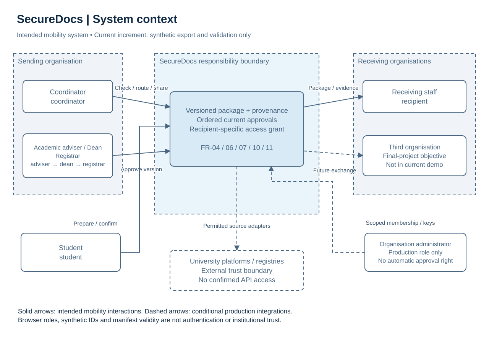
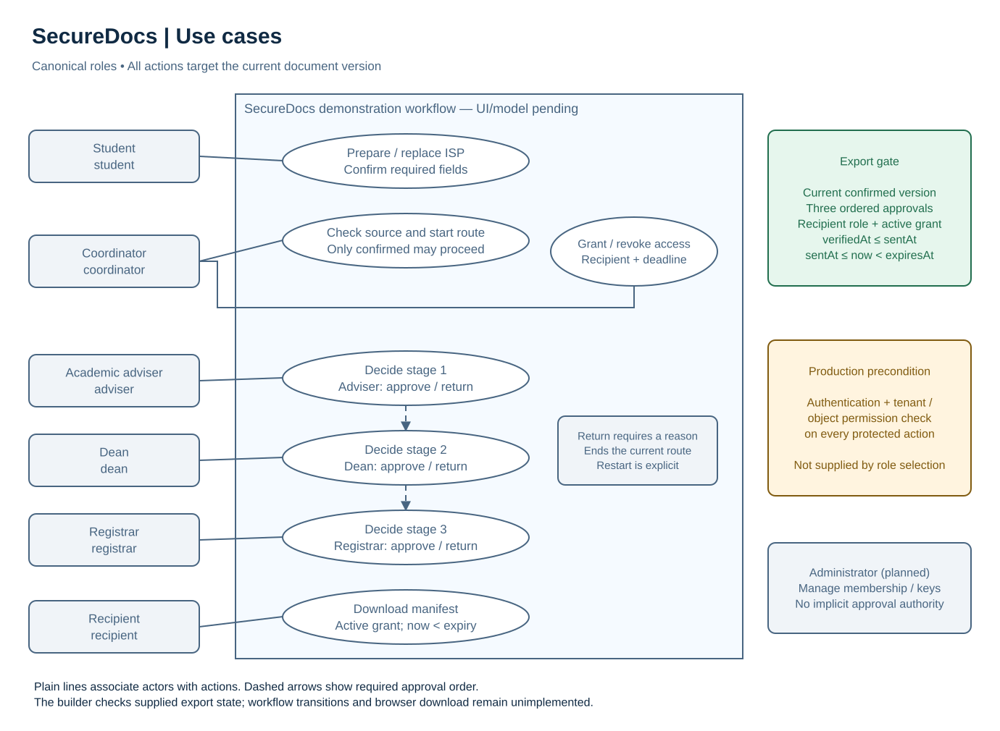
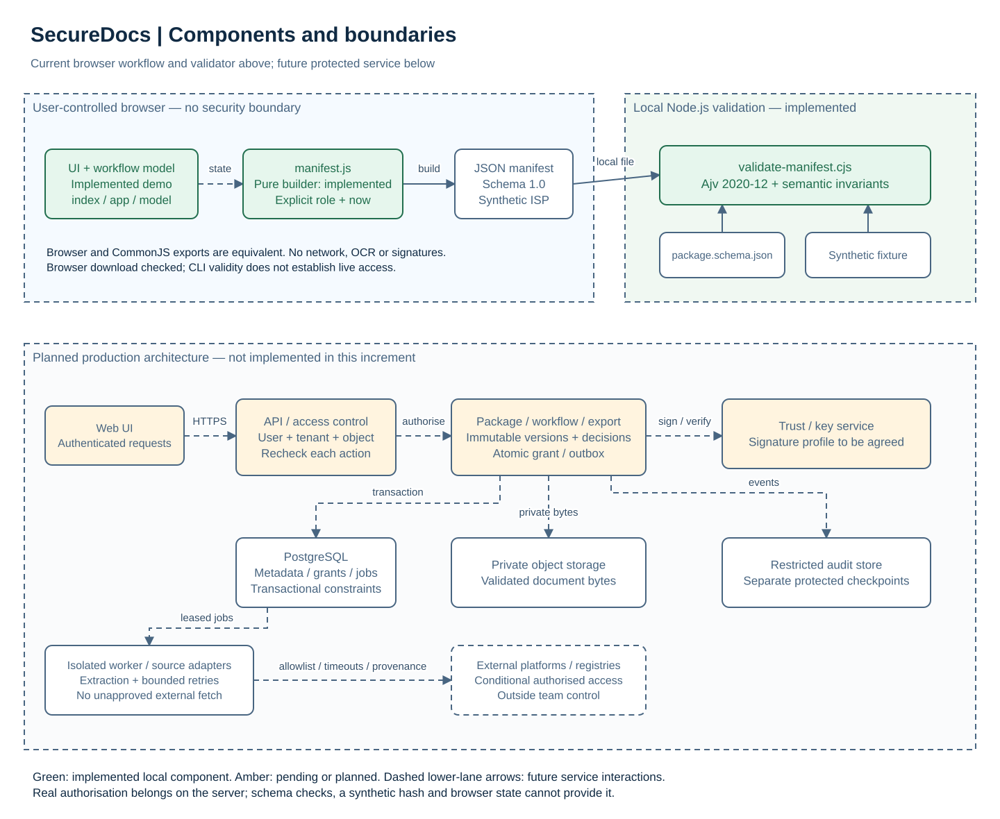

# 7 Architecture and diagrams

## System context and trust boundaries

SecureDocs is intended to connect a student, a sending organisation and receiving organisations around versioned educational documents. External registries, university platforms and partner systems remain outside team control. Their APIs and trust agreements are unconfirmed. The final-project demonstration must involve three organisations; the current synthetic profile names only a sender and one recipient.

Figure 1. Editable source: [context.drawio](../diagrams/context.drawio). Solid arrows describe the intended mobility interactions; dashed arrows are conditional production integrations. The boundary is a design responsibility boundary, not evidence of a running secured service. The implemented browser role simulation remains user-controlled.

## Use cases and roles

Figure 2. Editable source: [use-cases.drawio](../diagrams/use-cases.drawio). The six canonical demo roles have distinct actions. Adviser, dean and registrar act sequentially on the current version. Return requires a reason. The coordinator confirms the source, starts the route and grants/revokes access; the recipient downloads only while access is active. Production authentication/tenant permission checking is a mandatory precondition of every protected use case, not an optional extension. Organisation administration is a planned production role with no automatic academic authority.

## Components and current implementation

Figure 3. Editable source: [components.drawio](../diagrams/components.drawio). The upper lane contains the implemented browser workflow model/interface, shared builder and local validator. The lower lane shows proposed production components, which are not implemented.

The current builder consumes state and an explicit role/clock, creates fresh output and performs no I/O. Its CommonJS form shares timestamp parsing with the CLI. Ajv validates the local Draft 2020-12 schema without remote schema fetching, followed by semantic checks. The sample is wholly synthetic. The CLI inspects a file; it does not authenticate its author or contact a source. The state fields, callable interface and mapping are specified in [section 6](06-requirements.md#browser-state-and-integration-interface).

For production, the Web UI sends authenticated requests to a modular API. Access checks bind user membership, organisation, object and action on every request. Package/workflow modules own versions and sequential decisions; an export module assembles only authorised current records. A worker performs bounded document extraction and permitted source checks through isolated adapters. PostgreSQL holds metadata, jobs and grants; private object storage holds bytes; a restricted audit store records events. A future key service supports a separately agreed signature profile.

## Domain and consistency

The planned domain contains `Organization`, `User`, `Membership`, `Document`, immutable `DocumentVersion`, `Package`, `PackageItem`, `Approval`, `Verification`, `AccessGrant` and `AuditEvent`. Package items and approvals refer to a specific document version. Verification records method, source, time, outcome and limits. Grants bind recipient, version, expiry and revocation. The implemented synthetic workflow model uses a small in-memory projection of these entities.

A production upload validates/quarantines the file, computes its hash and creates a version. After extraction, the student confirms fields. The coordinator checks provenance and completeness, then starts the ISP route. Adviser, dean and registrar decide in order. A transactional send rechecks the current version, source and decisions before creating the grant and its audit/outbox entry. Concurrent replacement or source rechecking must prevent stale transmission. Download rechecks permissions and grant status at the action boundary, even if the page was opened before revocation.

The planned worker claims a leased job, applies bounded retries and records a distinct failure result. Crash/retry tests must establish that one logical send produces one grant/event, not duplicate side effects. Production replacement creates a new version and leaves old decisions as history only. The interactive prototype implements invalidation and timing; its event history is only in memory. Server atomicity, durable events and tenant security remain production requirements.

## Threats, controls and verification

The controls below are design proposals unless explicitly labelled current. They follow the least-privilege and per-request principles in [OWASP authorisation guidance](https://cheatsheetseries.owasp.org/cheatsheets/Authorization_Cheat_Sheet.html) and the destination/redirect validation principles in [OWASP SSRF guidance](https://cheatsheetseries.owasp.org/cheatsheets/Server_Side_Request_Forgery_Prevention_Cheat_Sheet.html).

| Threat / affected requirement | Proposed control and boundary | Verification condition / current status |
|---|---|---|
| Cross-tenant access or role escalation (FR-14, NFR-01) | Server checks membership, object scope and action; deny by default. Administrator membership is not approval authority. | Future API tests substitute another tenant's IDs and permissions at each endpoint and expect denial. Current role checks only illustrate the policy. |
| Stale approval after replacement or re-check (FR-06/07/08, NFR-03) | Immutable versions and version-bound decisions; transactionally recheck prerequisites at send/download. | Current model/manifest tests reject stale/misordered approvals, sent-version mismatch and access after replacement or any new verification. Production verification still requires concurrent-write tests. |
| QR/link SSRF and false source (FR-08, NFR-02) | Isolated fetcher, approved source registry, DNS/IP validation, no unrestricted redirects; block private/link-local/loopback destinations after resolution and on every hop. Retain provenance and limitations. | Future tests exercise redirects, rebinding, timeouts and lookalike sources. Current code never fetches `sourceRef`; simulation cannot establish real provenance. |
| Malicious PDF or data leakage (FR-01, NFR-02/05) | Content inspection, size/page limits, quarantine, isolated processing, private storage and minimal logs. | Future malformed/encrypted/oversized-document and log-content checks. Only synthetic input is used now; there is no upload path. |
| Replayed/duplicated transmission (FR-10/12, NFR-04) | Idempotency keys, unique constraints, leases and atomic grant/outbox creation. | Future duplicate request and crash-after-commit tests must produce one logical effect. Current model/browser checks reject duplicate live sends; the pure builder intentionally returns equivalent fresh output on repeated calls. |
| Forged manifest or compromised signing key (FR-16, NFR-03) | Agreed signature/canonicalisation profile, trusted organisation registry, scoped key access, rotation/revocation and recovery. | Future tampered-payload, unknown-key and revoked-key tests. Current SHA-256 string is synthetic; schema validity does not detect a forged issuer. |
| Access after revocation/expiry (FR-11) | Server checks live grant and trusted clock immediately before each download. | Current model, builder and active-validator tests reject revoked/expired state and exact expiry. Browser download and negative access scenarios were exercised. Live-server checks remain pending; local clock and copied JSON are not trusted authority. |
| Audit leakage or administrator rewriting history (FR-15, NFR-05) | Minimise logged fields, restrict audit access; retain separately protected checkpoints if a hash chain is adopted. | Future tests verify no PDF content/secrets in logs and detect edits against an independent checkpoint. An administrator rewriting both chain and checkpoint defeats that detection. Current `events` is not a tamper-resistant log. |

## Cryptographic boundaries

TLS protects a channel under its trust model; a file hash is neither a signature nor identity proof. At-rest encryption and separated keys are planned controls. Server OCR sees plaintext, so this architecture makes no end-to-end encryption claim. National-signature interoperability, legal recognition and key-owner authority need separate validation; there is no production cryptography in this increment. Revocation prevents future authorised downloads, not remote deletion of copies.

## Integration acceptance

The browser-generated manifest passed the schema and semantic validator with `--require-active`. The download action uses `SecureDocsManifest.buildManifest(state, {role, now})`; no alternative manifest format is constructed. Browser checks exercised invalidation, revocation and expiry denial, wrong-role/order actions, reasoned return, duplicate-send rejection, keyboard operation and narrow layout. If the builder is absent, export is disabled with an integration-pending explanation. These local checks establish demonstration integration, not production security or institutional approval; consolidated final assembly results remain separate.
