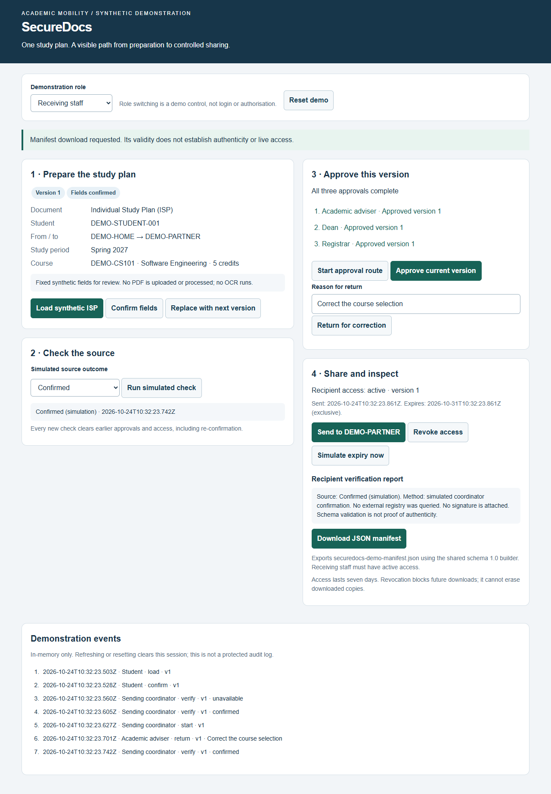

# 8 UX / prototype

The prototype makes preparation, source checking, approval and recipient access visible as separate stages. Six demonstration roles exercise one synthetic study plan, including rejected actions and version replacement. The interface provides English feedback, keyboard controls and a layout that adapts to narrow screens.

## Purpose and access

The [interactive prototype](../prototype/index.html) demonstrates one synthetic Individual Study Plan (ISP) from preparation to recipient download. It runs locally using the launch instructions in the [README](../README.md#install-and-run). A public hosted prototype URL has not been supplied. The demonstration uses fixed synthetic data; shared implementation limits are listed in [section 7](07-architecture.md#current-limitations).

The six canonical role identifiers are `student`, `coordinator`, `adviser`, `dean`, `registrar` and `recipient`; English display labels are separate. Role switching is a demonstration control, not authentication. All actions remain reachable so a wrong role or unmet prerequisite produces a text explanation instead of silently failing. If the shared manifest builder is unavailable, export is disabled and integration is shown as pending.

## Interaction and scenarios

| Scenario | Interaction | Expected observable result |
|---|---|---|
| UX-01 Preparation | Student loads the synthetic ISP and confirms the displayed fixed fields. | Version and confirmation are visible; sending remains blocked. FR-01/02/05 demonstration scope. |
| UX-02 Uncertainty | Coordinator chooses mismatch, not found, unavailable, manual review or not checked. | The outcome remains distinct; no approval route or export is allowed. FR-04/08. |
| UX-03 Confirmation | Coordinator simulates confirmed source and starts the route. | Waiting stage becomes Academic adviser; every new check clears old approvals and access. FR-06/08. |
| UX-04 Decisions | Adviser, dean and registrar approve in order. A return needs a nonblank reason. | Decisions reference the current version; return closes the route and requires explicit coordinator restart. FR-06/07. |
| UX-05 Replacement | Student replaces the synthetic item after approval or send. | Version increments; fields, verification, decisions, grant and timestamps reset. FR-07. |
| UX-06 Transfer | Coordinator sends after three current approvals; Receiving staff downloads. | Seven-day deadline appears; duplicate active send fails; the shared builder creates `securedocs-demo-manifest.json`. FR-09/10/12. |
| UX-07 Withdrawal | Coordinator revokes or simulates expiry. | Further recipient downloads fail. Simulated expiry changes the actual deadline as well as the label. FR-11. |
| UX-08 Correction | Wrong role/order, missing fields or blank return reason is attempted. | English feedback explains the rejected action; the accepted workflow state is unchanged. NFR-04/08. |

The interface separates source outcome, approval stage and recipient access. A recipient report explains the simulated method and limitations. Return text is rendered as text, not HTML. The selected route illustrates the merged design; institutional confirmation of the exact signatories is still pending.

Native buttons, labelled fields, visible keyboard focus and a polite live status region support keyboard operation. At narrow widths the two columns become a single column. The event list records successful transitions in memory, including return reasons and verification outcomes. Reset/refresh clears it; it is not a protected audit service. The download handler checks the current role, version and time again at activation, rather than relying on the earlier rendered state.

Figure 4. Local browser demonstration after adviser, dean and registrar approval of version 1 and a recipient download request. All identifiers and study-plan fields are synthetic. The image shows demonstration controls, source limitations and access expiry.

## Verification boundary

The UI/model, shared-builder download, negative access scenarios, keyboard route and narrow layout were exercised during this increment. The screenshot represents the implemented demonstration rather than a mock result. User evaluation remains separate from these checks; [section 9](09-verification.md) defines the planned experiment.
